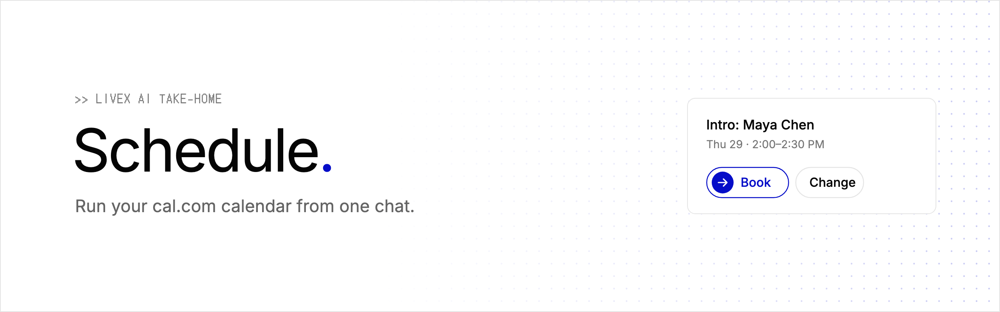
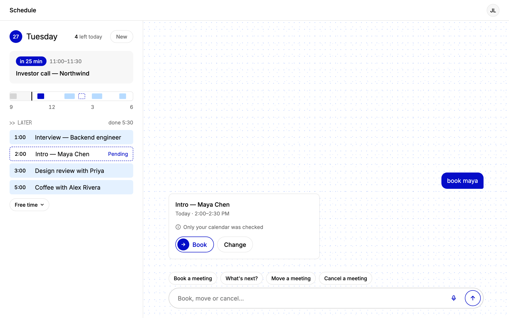
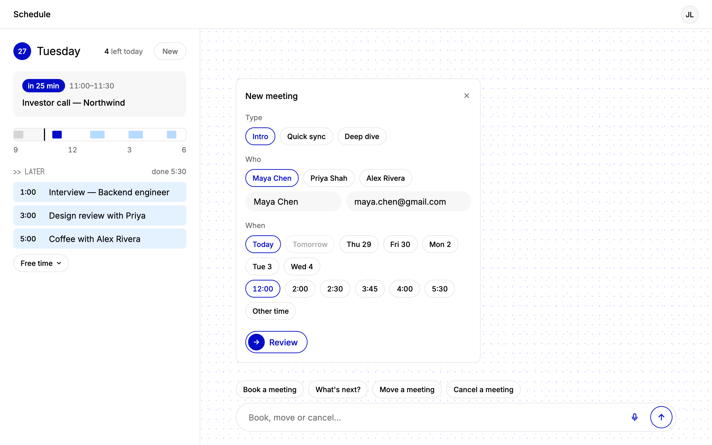
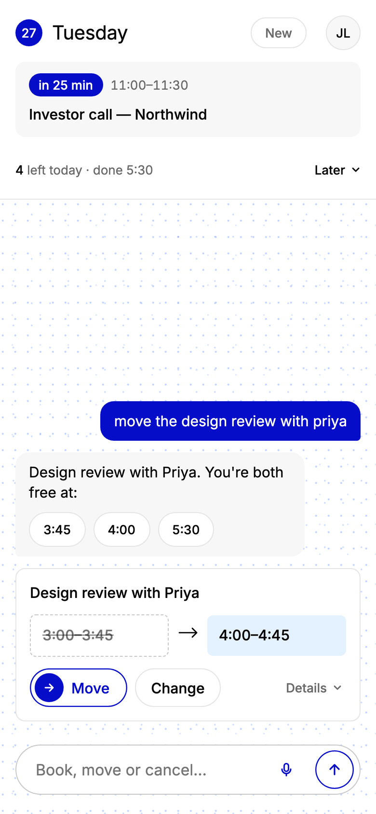
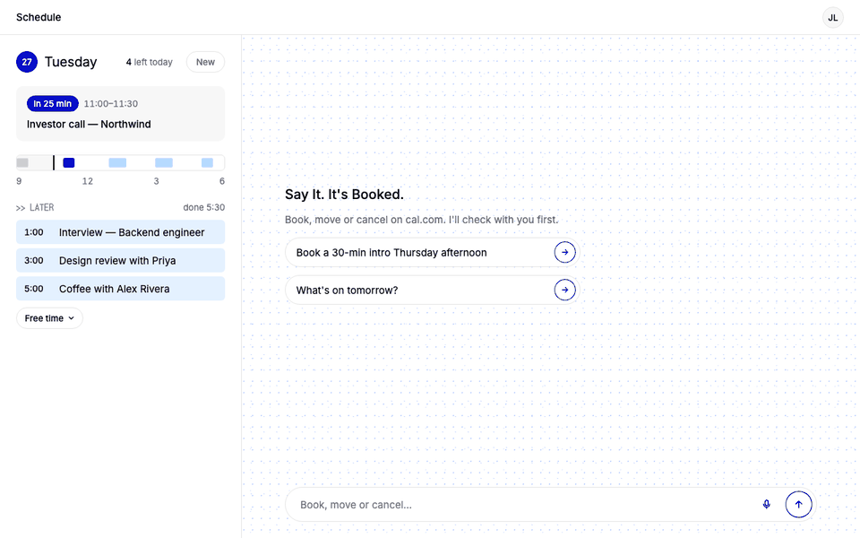
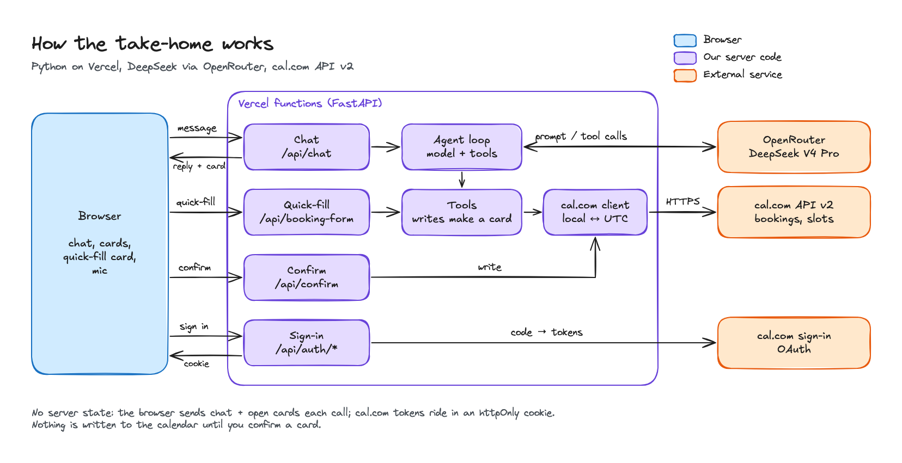

<p align="center">
  
</p>

<p align="center">
  <b>A chat assistant for a busy founder's cal.com calendar.</b><br>
  Say who and roughly when. It finds the closest open time, shows one card, and books on a single tap.
</p>

<p align="center">
  
  
  
  
  
  
</p>

<p align="center">
  <a href="https://livex-take-home.vercel.app"><b>Open the live demo →</b></a>
</p>

> [!NOTE]
> Built as a take-home for LiveX AI. You sign in with your own cal.com account (OAuth), so the demo reads and writes your calendar, never the author's. The cal.com OAuth client stays "pending" until cal.com approves it, and until then only its owner can sign in. If sign-in is refused, that is why.

<p align="center">
  
</p>

## What it does

- **Book in one message and one tap.** "Book maya" is enough. The bot finds Maya's email in your past bookings, picks the meeting type, and shows a Book card. Nothing is written until you tap Book.
- **Closest open time.** If the time you asked for is taken, it proposes the nearest open time and puts the next few as buttons: "7:00 is taken. 5:30 is the closest."
- **Move a meeting.** "Move the design review with Priya" shows the old and new time side by side, with other open times as buttons.
- **Cancel with undo.** Tapping Cancel it starts an 8-second undo toast. cal.com only hears about it, and only emails the attendee, once the toast runs out.
- **See the day.** A today panel shows what's next and the rest of the day. "What's on Thursday" switches it to Thursday.

When the bot doesn't know who or when, it opens a quick-fill card instead of asking in text: meeting types, your most-booked people and your open times, all as taps. The mic uses the browser's own speech recognition, so no audio reaches our server.

<table>
  <tr>
    <td width="68%"></td>
    <td width="32%"></td>
  </tr>
  <tr>
    <td align="center"><sub>Quick-fill card: every field is a tap</sub></td>
    <td align="center"><sub>Phone, 390 px wide</sub></td>
  </tr>
</table>

## How it feels

| Task | Effort |
|---|---|
| Book, by message | 1 message + 1 tap |
| Move, by message | 1 message + 1 tap |
| Cancel, by message | 1 message + 1 tap (Undo is 1 more, if you want it) |
| See a day | 1 message |
| What's next | 1 tap |
| Book without typing | 5 taps: open the quick-fill card, person, time, Review, Book |

Counted with a scripted Playwright walkthrough of the real UI against a mock backend. The live model can take an extra turn when a request is ambiguous, for example two meetings at 3:00.

<p align="center">
  
</p>

## Architecture

<p align="center">
  
</p>

[Open the full board on Excalidraw.](https://excalidraw.com/#json=yYDqKLkUNrX7Zm4TQH8JU,gKfT3dPvmD-aJmbIqakBhg)

- **The server keeps nothing.** Each request carries the chat history and open cards from the browser, so any Vercel instance can answer it. The server only accepts user, assistant and tool messages in that history, so it can't replace the system prompt.
- **Writes wait for a tap.** The `book`, `reschedule` and `cancel` tools never call cal.com. They return a card. `POST /api/confirm` makes the real call. Typing "y" or "yes" with exactly one card open does the same, except for a cancel, which has to go through the undo toast.
- **Local time in, UTC out.** The browser sends its IANA time zone with every message. The prompt gets the current local time, the next 14 dates with weekdays, and fixed meanings for "morning", "afternoon" and "evening". The model reads and writes local times only, and `timeutil.py` converts them to UTC for cal.com.
- **Tokens in an httpOnly cookie.** Sign-in is cal.com OAuth. The access and refresh tokens live in an httpOnly `cal_tokens` cookie, refreshed a minute before they expire. Middleware writes a refreshed pair back on every response, failed ones included, because cal.com may retire the old refresh token.
- **History in the browser.** The browser sends one request at a time, so two requests never refresh the token at once. The server trims history to the last 40 messages before each model call.

## Code map

| File | What it does |
|---|---|
| `app.py` | FastAPI routes: sign-in, `/api/chat`, `/api/confirm`, `/api/booking-form`, `/api/propose`, `/api/schedule`. Checks what the browser sends. Serves `static/`. |
| `agent.py` | The agent loop (up to 6 tool rounds), the system prompt and tool schemas, the quick-fill data, and contact ranking from booking history. |
| `auth.py` | cal.com OAuth: login URL with a `state` check, code exchange, token refresh. |
| `calcom.py` | Thin httpx client for cal.com API v2, with the right `cal-api-version` per endpoint. Retries reads on 429 and 5xx, never writes. |
| `store.py` | Per-request session and pending changes. Nothing outlives the request. |
| `timeutil.py` | Date context for the prompt and local ↔ UTC conversion. |
| `static/` | Plain HTML, CSS and JS, no build step. Chat, cards, today panel, quick-fill card, undo toast, mic. |
| `tests/` | pytest suite against a fake cal.com and a scripted model. |
| `docs/` | Build plan, brand kit and the architecture board. |

## Design decisions and trade-offs

**Stateless on Vercel.** Testers open a link and sign in, with nothing to install. Serverless functions don't share memory, so the chat lives in the browser and the tokens in a cookie. That's safe because every cal.com call uses the visitor's own token: editing what the browser sends can only touch their own calendar.

**The browser enforces "a card runs once".** With no server storage there is nowhere to record that a `change_id` was used, so the button disables on the first tap and every other button on that card goes with it. A crafted request could replay a card, but only against the sender's own calendar. In production this moves to a Postgres write log.

**Only the founder's calendar is checked.** Open times come from cal.com's slots for the founder's event type. The attendee's calendar is never read. They get cal.com's email invite and can decline or reschedule from there. The card says "Only your calendar was checked" so nobody assumes otherwise.

**Thinking is off.** With DeepSeek's reasoning on, it rejects any tool turn whose reasoning isn't passed back, and replies are slower. With it off, tool calls are reliable and a booking turn is quicker. The prompt sets fixed rules instead: act first, never ask a yes/no question a tool call can answer, never invent an email. A turn also ends as soon as everything it called has put something on screen, which saves a second model call.

**An 8-second undo held in the browser.** cal.com emails attendees the moment a cancel lands, so a real undo has to delay the call. The browser shows the toast and only calls `/api/confirm` when it runs out. The cost: close the tab inside those 8 seconds and the cancel never happens.

**Known limits**

- A write that times out is not retried, because cal.com documents no idempotency key on create. The bot says "check your calendar" instead.
- The today panel polls every minute. Changes made outside the chat show up on the next poll, not instantly.
- Contacts come from your cal.com bookings in the last 180 days and next 30. Someone you've never booked with needs an email.
- Voice is hidden in browsers without the Web Speech API, such as Firefox.
- Chats aren't saved across devices or a cleared browser.

## Run locally

Requires Python 3.12+ and [uv](https://docs.astral.sh/uv/).

```bash
uv sync
```

Create a `.env` in the repo root:

```bash
LIVEX_OPENROUTER_API_KEY=...      # OpenRouter key
CAL_OAUTH_CLIENT_ID=...           # from your cal.com OAuth client
CAL_OAUTH_CLIENT_SECRET=...
PUBLIC_URL=http://localhost:8000  # optional, this is the default
```

On your cal.com OAuth client, register this redirect URI exactly:

```
http://localhost:8000/api/auth/callback
```

Then start the server and open http://localhost:8000:

```bash
uv run uvicorn app:app --port 8000
```

## Tests

```bash
uv run pytest -q
```

The suite runs offline in under a second, against a fake cal.com and a scripted model. It guards the promises the app makes:

- Nothing reaches cal.com until a card is confirmed, and a failed confirm still uses the card up.
- Times land where the founder meant them, across time zones and a daylight-saving change.
- Sign-in survives the awkward cases: a cal.com hiccup on refresh, a refresh that lands on a failed request, a tampered cookie.
- Whatever the browser sends (history, cards, dates) is checked, and bad input gets a clear error, not a crash or a huge model bill.
- The fast paths stay fast: one slots call is enough, a turn ends once the card is on screen, and a known first name resolves to an email.

## What I'd do next

1. **Real storage.** Postgres for users, chats, pending changes and a write log, so "a card runs once" and undo move to the server. Tokens stored encrypted, with the key in a secrets manager.
2. **Safe retries.** Record each write as "running" before calling cal.com. On a timeout, list bookings to see whether it went through before trying again.
3. **Live updates.** cal.com webhooks (`BOOKING_CREATED`, `BOOKING_RESCHEDULED`, `BOOKING_CANCELLED`) refresh a cache and push changes to the today panel.
4. **Evals before deploys.** One pinned model everywhere. A new version ships only after the eval set passes, with traces on every model and cal.com call.
5. **Rate limits per user** before calling the model or cal.com, which allows 120 requests a minute per key.
